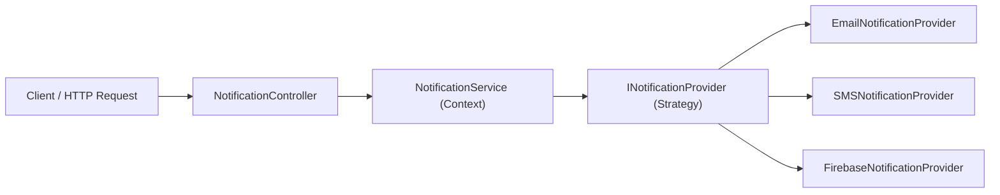

# Flexible Notification Service

A clean, extensible notification service built with **ASP.NET Core (.NET 10)** demonstrating the **Strategy Design Pattern**. It dispatches notifications across multiple channels (`Email`, `Sms`, `Firebase`) without coupling the core service to channel-specific implementations.

---

## Architecture & Strategy Pattern



- **Strategy Interface (`INotificationProvider`)** — Defines `Type` and `SendAsync(NotificationMessage)` contract for every notification channel.
- **Concrete Strategies** — `EmailNotificationProvider`, `SMSNotificationProvider`, and `FirebaseNotificationProvider` implement channel-specific delivery logic.
- **Context (`NotificationService`)** — Receives all registered `INotificationProvider` instances via Dependency Injection and selects the matching provider at runtime based on `NotificationMessage.Type`.

---

## Project Structure

```text
FlexibleNotification/
├── FlexibleNotification.API/          # ASP.NET Core Web API
│   ├── Controllers/
│   │   └── NotificationController.cs  # POST /api/notification/send
│   ├── FlexibleNotification.API.http  # Sample HTTP requests
│   └── Program.cs                     # DI registration & JSON enum configuration
├── FlexibleNotification.Domain/       # Core models, strategies & services
│   ├── Enums/
│   │   └── NotificationType.cs        # Email, Sms, Firebase
│   ├── Interfaces/
│   │   ├── INotificationProvider.cs
│   │   └── INotificationService.cs
│   ├── Models/
│   │   └── NotificationMessage.cs
│   ├── Providers/
│   │   ├── Email/EmailNotificationProvider.cs
│   │   ├── Sms/SMSNotificationProvider.cs
│   │   └── Firebase/FirebaseNotificationProvider.cs
│   └── Services/
│       └── NotificationService.cs
└── FlexibleNotification.Shared/       # Shared primitives & extensions
    ├── DevCode.cs                     # JsonStringEnumConverter extension
    └── Result.cs                      # Standardized operation result
```

---

## Prerequisites

- [.NET 10 SDK](https://dotnet.microsoft.com/download)

---

## Getting Started

1. **Clone the repository**
   ```bash
   git clone https://github.com/phonewinttun-dev/FlexibleNotification.git
   cd FlexibleNotification
   ```

2. **Build the solution**
   ```bash
   dotnet build FlexibleNotification.slnx
   ```

3. **Run the API**
   ```bash
   dotnet run --project FlexibleNotification.API
   ```
   The API listens on `http://localhost:5282` (and `https://localhost:7054` for the `https` profile).

---

## API Usage

### Endpoint

`POST /api/notification/send`

`NotificationType` accepts string values (`"Email"`, `"Sms"`, `"Firebase"`) via `JsonStringEnumConverter`.

### Example Request

```http
POST http://localhost:5282/api/notification/send
Content-Type: application/json

{
  "type": "Email",
  "to": "user@example.com",
  "subject": "Welcome",
  "body": "Hello from Flexible Notification Service!"
}
```

### Example Response (`200 OK`)

```json
{
  "isSuccess": true,
  "message": "Email sent to user@example.com",
  "isFailure": false
}
```

 Ready-to-run requests for all channels are available in `FlexibleNotification.API/FlexibleNotification.API.http`.

---

## Extending with a New Channel

To add a new channel (e.g., `WhatsApp`) without modifying `NotificationService`:

1. Add `WhatsApp` to `NotificationType` enum.
2. Create `WhatsAppNotificationProvider : INotificationProvider` under `FlexibleNotification.Domain/Providers/WhatsApp/`.
3. Register it in `Program.cs`:
   ```csharp
   builder.Services.AddScoped<INotificationProvider, WhatsAppNotificationProvider>();
   ```
